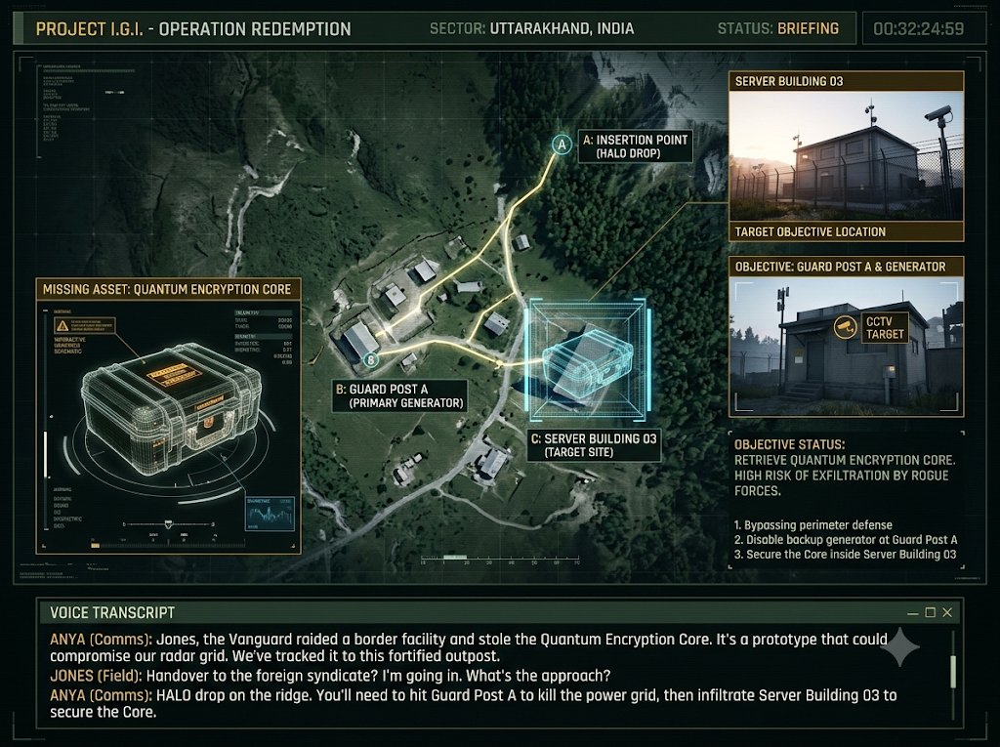
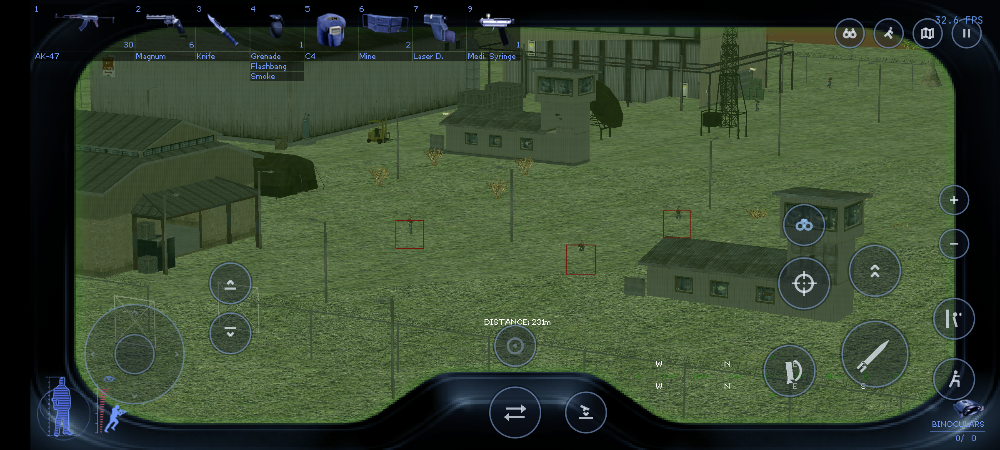

# Project I.G.I. — Operation Redemption

**Location:** Uttarakhand sector, India  
**Operative:** David Jones  
**Tactical support:** Anya Romanov  
**Objective:** Recover the stolen Quantum Encryption Core from Server Building 03.

## Mission story

The Himalayan Vanguard raided an Indian defense facility and stole a classified Quantum Encryption Core. If it reaches a foreign syndicate, the northern border radar and defense grid could be compromised. Jones is inserted by HALO at dawn and must enter the valley compound, recover the Core and reach canyon extraction.

The opening briefing art is [briefing/briefing-screen.png](briefing/briefing-screen.png). Its generated voice-over and caption transcript are [briefing/briefing.wav](briefing/briefing.wav) and [briefing/briefing_captions.txt](briefing/briefing_captions.txt). The full dialogue source is [briefing/transcript.json](briefing/transcript.json).

## Objectives

1. Breach the perimeter while avoiding the main watchtower cameras.
2. Sabotage Guard Post A's generator to disable the two outer-zone cameras.
3. Take the security keycard and reach Server Building 03.
4. Hack its vault terminal to disable the remaining cameras and unlock the Core.
5. Recover the Core and exfiltrate to the canyon extraction.

Any guard detection can raise the alarm. When it does, the alarm is sent to both guard squads and the Core interaction is permanently locked. Extraction only completes after the Core has been secured.

## Compound

The generated 500 × 500 metre valley contains a mountain insertion ridge, a cleared drop pocket, internal roads, perimeter chain-link fence, entrance checkpoint and rear service gate, vegetation, lights and a lake-side extraction. Twelve placed structures use retail game models and interiors:

- Guard Post A and the main gate booth
- Three watchtowers
- Barracks and command building
- Vehicle depot and logistics warehouse
- Server Building 03, communications bunker and armory

The level wires 23 building doors and six gate leaves. Doors include unlocked, pickable, keycard-controlled and terminal-controlled routes; the generator self-test checks generated task wiring and door/gate geometry. The mission also includes six cameras, fifteen guards in two squads, eight walking patrol routes, mission status messages, a security alarm and furnishings based on available retail models.

## Current implementation limits

Buildings, furnishings, terrain material and much of the vegetation are retail-derived, not new custom architectural assets. The intelligence building is a two-storey reused structure. Bespoke glass, ladders, ventilation/basement routes, all the requested room-specific set dressing, moving vehicles, and full alarm-driven occupancy changes are not implemented. The mission generator and phone smoke check do not prove every door, interaction or AI path works under player control.

## Phone evidence

This is a real phone capture of the generated compound running in the Android build. It verifies startup and rendering only; a full playthrough through the alarm fail-state, building interiors, terminal, Core and extraction has not been completed.
